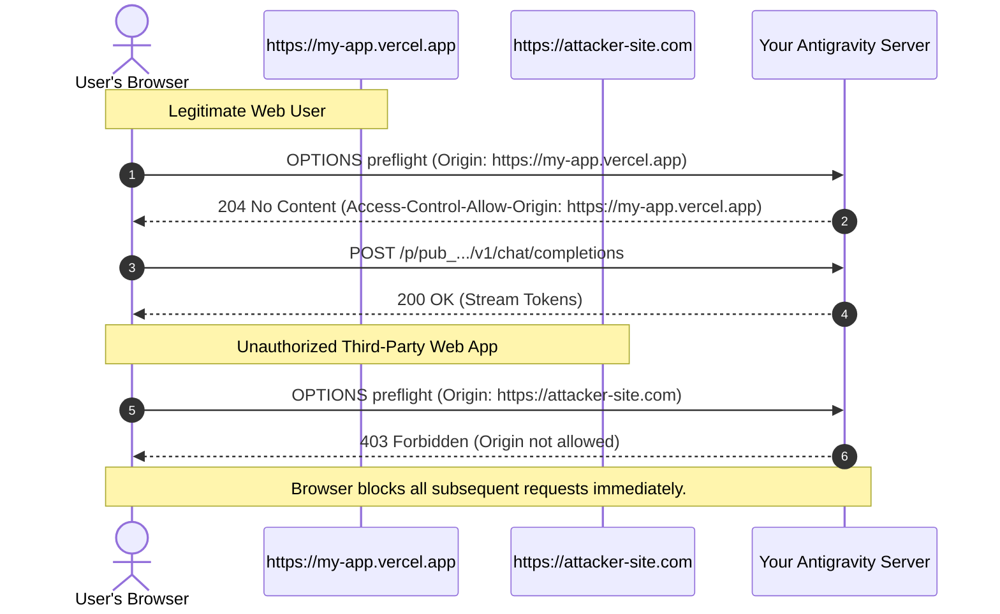

# 02 - Web Applications & CORS Whitelisting Guide

This guide explains how to connect browser-based Web Apps (React, Vue, Next.js, Svelte, or Vanilla JavaScript) to your Antigravity Server securely using CORS domain whitelisting.

---

## 1. What is an Origin?

An Origin is defined by the web standard as:
$$\text{Origin} = \text{Protocol} + \text{Domain/Host} + \text{Port}$$

### Valid Origin Examples:
- Production: `https://my-cool-app.vercel.app`
- Custom Domain: `https://chat.mycompany.com`
- Local Testing: `http://localhost:5173` (Vite) or `http://localhost:3000` (Next.js/React)

### Invalid Origin Examples:
- ❌ `https://my-cool-app.vercel.app/` *(Do NOT include trailing slashes)*
- ❌ `my-cool-app.vercel.app` *(Must include `https://` or `http://`)*
- ❌ `https://my-cool-app.vercel.app/chat` *(Do NOT include subpaths or routes)*

---

## 2. Setting CORS in the Dashboard

1. In your **Antigravity Server Dashboard**, create or edit your application.
2. In the **Allowed Origins (CORS Whitelist)** field, enter your exact frontend origin.
3. If you want to support both local development and your live production deployment, separate them with a comma:
   ```text
   http://localhost:5173, https://my-cool-app.vercel.app
   ```
4. Click **Save Changes**.

---

## 3. Frontend Implementation (JavaScript / React / Vue)

You can call the Keyless Endpoint directly from client-side JavaScript. Notice that **no API key** is included in your source code:

```javascript
/**
 * Stream completions from Antigravity Virtual Middleware directly to a web page.
 * @param {string} promptText - The user message
 * @param {function} onToken - Callback invoked for every incoming token chunk
 */
async function streamChatCompletion(promptText, onToken) {
  // Use your app's unique Keyless Endpoint
  const url = "https://<your-tunnel>.trycloudflare.com/p/pub_4f8a29c1e7/v1/chat/completions";

  const response = await fetch(url, {
    method: "POST",
    headers: {
      "Content-Type": "application/json"
      // No Authorization or Bearer header!
    },
    body: JSON.stringify({
      model: "gemini-2.5-pro",
      messages: [
        { role: "system", content: "You are a helpful AI assistant." },
        { role: "user", content: promptText }
      ],
      stream: true
    })
  });

  if (!response.ok) {
    const errorText = await response.text();
    throw new Error(`Request failed (${response.status}): ${errorText}`);
  }

  // Parse Server-Sent Events (SSE) stream
  const reader = response.body.getReader();
  const decoder = new TextDecoder("utf-8");
  let buffer = "";

  while (true) {
    const { done, value } = await reader.read();
    if (done) break;

    buffer += decoder.decode(value, { stream: true });
    const lines = buffer.split("\n");
    buffer = lines.pop(); // Retain incomplete line

    for (const line of lines) {
      const trimmed = line.trim();
      if (!trimmed || trimmed === "data: [DONE]") continue;

      if (trimmed.startsWith("data: ")) {
        try {
          const parsed = JSON.parse(trimmed.slice(6));
          const token = parsed.choices?.[0]?.delta?.content || "";
          if (token) onToken(token);
        } catch (e) {
          console.error("Failed to parse SSE chunk:", trimmed, e);
        }
      }
    }
  }
}
```

---

## 4. How the Security Wall Works



### Why this is completely secure:
1. **The browser enforces Origin headers**: JavaScript running in a browser **cannot forge** the `Origin` header. The browser guarantees it represents the actual domain hosting the page.
2. **Instant 403 Rejection**: If any other website (e.g. `https://malicious-site.com`) copies your keyless URL and tries to call it from their site, your server rejects the preflight request with `403 Forbidden`.
3. **No Key Exposure**: Even if someone inspects your browser bundle, they find only a public route slug with strict domain whitelisting, preventing unauthorized third-party site embedding.
